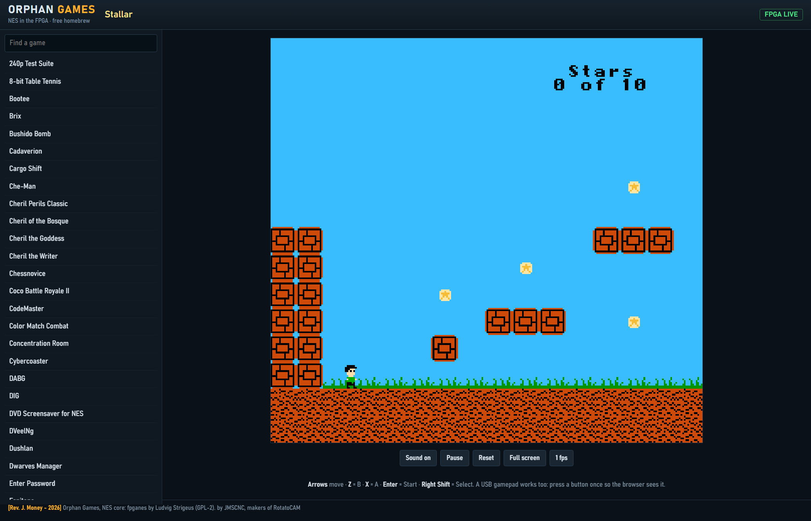

# Orphan

**FPGA Dev Linux for the S9 Control Board** · by JMSCNC, makers of RotatoCAM ([jmscnc.com](https://jmscnc.com))

In Bitcoin, an *orphan block* is one the chain left behind. Orphan is for the control boards the mining world left
behind: the Antminer S9's controller has a Xilinx Zynq XC7Z010 (a dual-core ARM plus an FPGA), 512 MB of RAM,
Ethernet, 51 free FPGA pins, and costs a few dollars used. Orphan turns it into a hacker's bench computer with a
BBS-style menu, FPGA projects you load in one keypress, and instruments built inside the FPGA:
a 4-slice software radio, an 8-voice synthesizer, and a NES game console.


| | |
|---|---|
|  |  |
| The login menu (hotkeys spell MY ORPHAN LIFE) | Orphan Synth's web panel |
|  | |
| Orphan Games: the NES runs in the FPGA, you play in the browser | |

## What you get

- **The Orphan menu** at login: file manager, system info, live fan control and rpm, LED toys, board status
  (temperature, voltages, FPGA state), network, and **FPGA projects**: pick one, read what it does and how to wire
  it, press Enter to load it.
- **29 FPGA projects** with descriptions: Ardzy's 19 examples (LED strips, steppers, VGA, audio, RISC-V, an FM
  transmitter, a SHA-256 miner, neural networks in the FPGA, ...), 6 starters and tests, and Orphan's own four:
- **Orphan Radio (Orphan 7600)**, a software defined receiver in the FPGA, 1 kHz to 49 MHz from one pin:
  - 4 tuners (slices A to D) and a wide panadapter (6.25 MHz down to 390 kHz), click to tune, drag to pan
  - AM, SAM, USB, LSB, CW, NFM; noise blanker and 50/60 Hz hum filter in the FPGA, auto-notch
  - decoders that run on the board: CW (Morse), NAVTEX, WWVB time code, SSTV pictures (Martin, Scottie,
    Robot 36, PD)
  - band plan on the dial, scanner with auto-program, memories, audio in the browser or `ffplay`
- **Orphan Synth**: 8 voices with a 6-oscillator mixer, filter and envelopes per voice, 2 LFOs and a mod matrix,
  drive and bitcrusher, long delay and a looper in RAM, arpeggiator, presets, LED light shows. Play it from the
  web page, the terminal keyboard, or MIDI over the network.
  The radio can also use an RTL-SDR stick on your PC as a second source (`radio/nesdr-remote`), with the same
  panel, scanner and decoders.
- **Orphan Games**: a Nintendo Entertainment System rebuilt in the FPGA (fpganes by Ludvig Strigeus): CPU,
  picture and sound chips and cartridge mappers 0 to 4 in hardware. Pick a game in the browser and play with the
  keyboard or a USB gamepad, picture and sound at 30 frames a second. Bring your own free homebrew `.nes` files.
- **Orphan Graphics Toys**: a raycaster, color waves, XOR patterns and the Game of Life drawn by the FPGA.
- **ORPHAN Remote** (`cyd-remote/`): firmware that turns a $15 ESP32 "Cheap Yellow Display" into a Wi-Fi touch
  screen for the board: system, radio and synth views, and a screen for Graphics Toys and Games.
- **Fan control in every Orphan design**: the S9's fans keep working whatever design is loaded.

Orphan is an add-on for [Ardzy](https://github.com/chrysovalantischryso/ardzy), chryso's Debian 13 system and
FPGA toolchain for this board. Ardzy brings the kernel, the `ardzy` command, the web app and the example projects;
Orphan installs next to it.

## Getting started

### You need

- An **Antminer S9 control board** (the one with the Zynq XC7Z010; often sold alone as a spare)
- A **12 V supply** with a 6-pin PCIe plug
- A **microSD card**, 8 GB or more
- An **Ethernet cable** to your router, and a PC on the same network
- Recommended: a fan on one of the board's fan headers, or a heatsink on the Zynq

### 1. Put Ardzy on the SD card

1. Download `Ardzy-0.3-sdcard.img.xz` from [Ardzy's releases](https://github.com/chrysovalantischryso/ardzy/releases).
2. Write it to the card with balenaEtcher (or the Ardzy Windows app: **SD card**, choose the image, Write).
3. Set the boot jumpers to SD card: **JP2 = 1, JP4 = 1**.
4. Put the card in, plug in Ethernet, then power.
5. After about 2 minutes the board answers as **ardzy.local**:

```sh
ssh root@ardzy.local          # password: root
passwd                        # change it now
```

### 2. Install Orphan on the board

```sh
apt update && apt install -y git
git clone https://github.com/revjmoney/orphan
cd orphan
sh orphan/setup-board.sh orphan     # "orphan" = the new hostname
```

Log out and back in (`ssh root@orphan.local`): the Orphan menu opens. `orphan` opens it any time.
Run `setup-board.sh` again after a `git pull` to update.

### 3. Try the radio and the synth

- **Radio**: in the menu press **R**, then Enter. Open `http://orphan.local:8000` in a browser and press **SPK**
  for sound. Listen on the PC without a browser:
  `ffplay -nodisp -f s16le -ar 12207 -ch_layout mono -fflags nobuffer tcp://orphan.local:8001`
- **Synth**: **F** FPGA projects, **Sound toys**, Orphan Synth. It opens the terminal keyboard right there; the web
  panel is on port 8000.
- **Games**: copy free homebrew `.nes` files to `/opt/orphan-games/roms/nes` on the board, then **F** FPGA projects,
  **Games**, Orphan Games. Open `http://orphan.local:8000`, pick a game, press **Sound on**. Arrows move, Z / X are
  B / A, Enter is Start. Many authors share their NES games freely (for example on nesdev.org and itch.io): check
  each game's license before you share it further.

**Antenna**: the radio's input is **J8 pin 12**. A plain wire works as a first test (the FPGA biases the pin
itself), but it mostly shows the board's own noise. A resistor and a capacitor make a proper 1-bit ADC front end:
R from J8 pin 15 to the input node, C from the node to ground (see the radio's project page in the menu).
Front-end values and measured sensitivity will be published after bench tests.

## More

| | |
|---|---|
| [docs/hardware.md](docs/hardware.md) | the board, jumpers, headers, LEDs, fans |
| [docs/pinmap.md](docs/pinmap.md) | every FPGA pin on the headers |
| [docs/projects.md](docs/projects.md) | build and change the FPGA designs (Yosys + nextpnr, no Vivado) |
| [docs/netboot.md](docs/netboot.md) | run a second board from a Linux PC over the network (no SD card) |
| [docs/flash.md](docs/flash.md) | advanced: boot Orphan from the board's own NAND flash |

Keep several boards identical from a PC: `bash orphan/sync-boards.sh <board ip> ...` installs the menu and the
same project set on each.

## Safety

- **Your network**: the web pages and Ardzy's API have no login. Use Orphan on a network you trust, and change the
  root password.
- **Radio transmitting**: Orphan Radio has a test transmitter on J8 pin 5, and Ardzy's FM transmitter project
  drives a pin with RF. Keep them on short wires or into a dummy load or a resistor plus attenuator into an SDR.
  Do not connect an antenna to them: transmitting needs a license where you live.
- **Heat**: the menu's **About this board** and **Cooling** screens show the chip temperature and fan speed.

## License

Orphan is free software: **GPL-3.0-or-later** (`LICENSE`) with two additional terms (`ADDITIONAL-TERMS.md`): keep
the "by JMSCNC, makers of RotatoCAM" credit, and a modified version must use its own name and logo.
The monkey logo is not GPL (`LOGO-LICENSE.md`). Credits for everything Orphan builds on are in `NOTICE.md`.
No Bitmain software, firmware or schematic is in this repository.

[Rev. J. Money - 2026]
