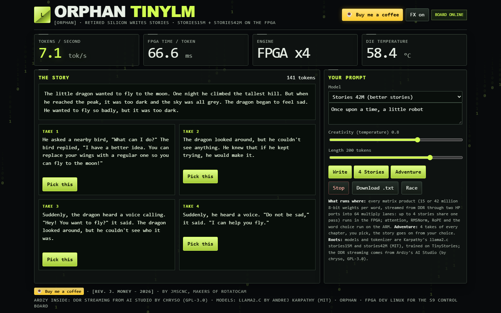
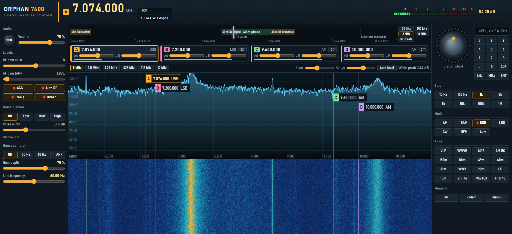
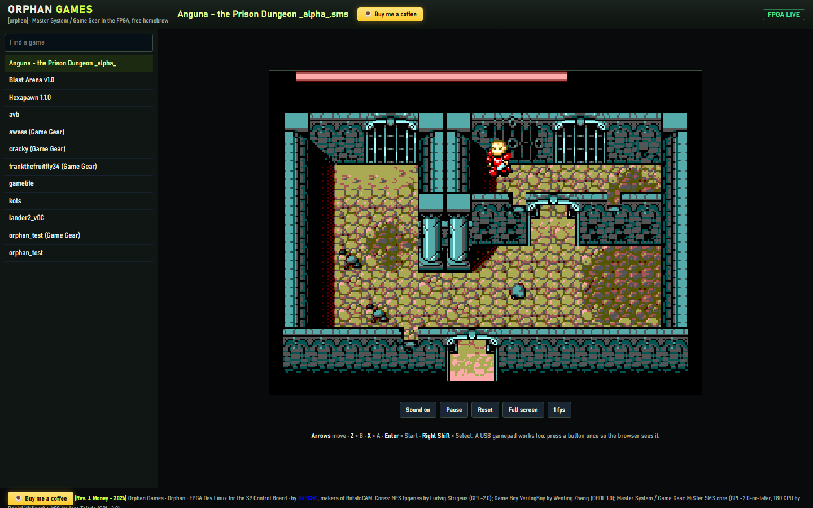
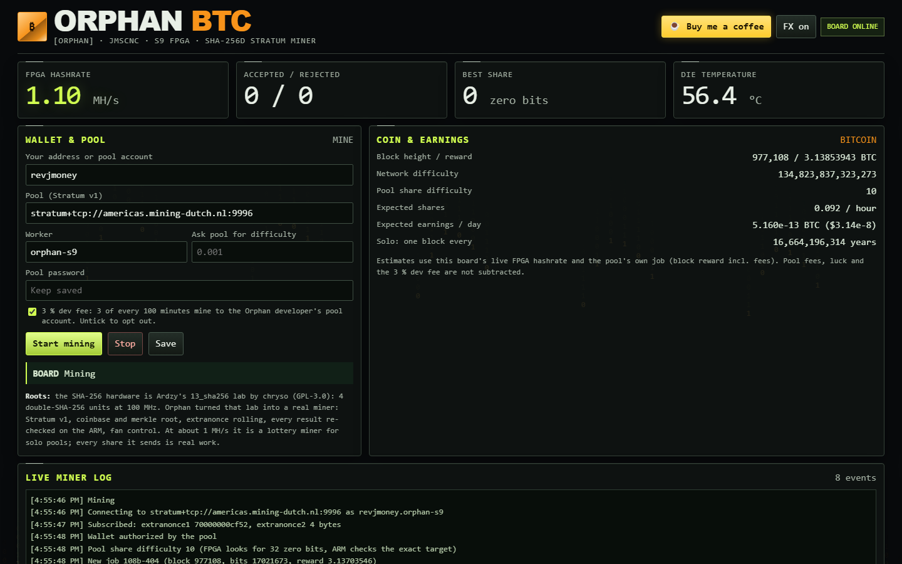
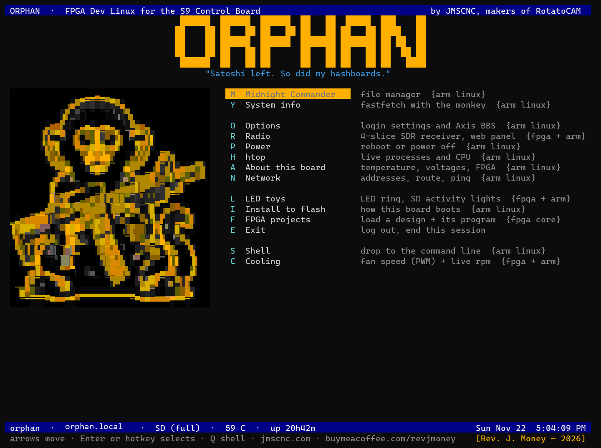
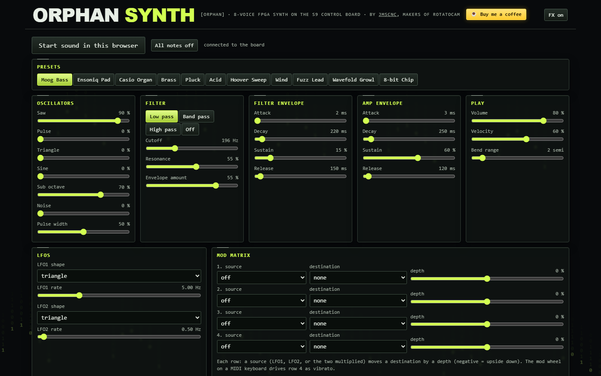

# ORPHAN

**FPGA Dev Linux for the S9 Control Board** · by JMSCNC, makers of RotatoCAM ([jmscnc.com](https://jmscnc.com))

[](https://buymeacoffee.com/revjmoney)
**Website: [revjmoney.github.io/orphan](https://revjmoney.github.io/orphan/)**

In Bitcoin, an *orphan block* is one the chain left behind. Orphan is for the control boards the mining world left
behind: the Antminer S9's controller has a Xilinx Zynq XC7Z010 (a dual-core ARM plus an FPGA), 512 MB of RAM,
Ethernet, 51 free FPGA pins, and costs a few dollars used. Orphan turns it into a hacker's bench computer: a
BBS-style menu, a web control page, and instruments, game consoles, a miner and a **language model built inside
the FPGA**.

![The Orphan board page: matrix rain, metric tiles, the [orphan] / [ardzy] project tree](docs/screenshots/board.png)

| | |
|---|---|
|  |  |
| **Orphan TinyLM**: a Llama writes stories on the FPGA; Adventure = 4 takes per chapter, you pick | **Orphan Radio**: four tuners and a panadapter, 1 kHz to 49 MHz |
|  |  |
| **Orphan Games**: NES, Game Boy, Master System and Game Gear as FPGA cores | **Orphan BTC**: a real Stratum SHA-256 miner with a coin and earnings panel |
|  |  |
| The login menu (hotkeys spell MY ORPHAN LIFE) | **Orphan Synth**: 8 voices in the FPGA |

## What you get

**The Orphan menu** at login: file manager, system info, fan control with live rpm, LED toys, board status
(temperature, voltages, FPGA state), network, and **FPGA projects** as a tree: `[orphan]` and `[ardzy]`, each split
into `[games]`, `[mining]`, `[science]`, `[radio & sound]`, `[lab toys]`, `[starters & tests]`. Every item says where
it runs: `{fpga core}`, `{arm linux}` or `{fpga + arm}`. Every project has a description and a quick start.

**The board page** (`http://orphan.local`): the same tree in the browser, in the Orphan look (matrix rain, lime,
translucent cards). Click a project for its quick start and wiring; **Load** starts it and opens its own page in a new
tab. Ardzy's upload, program output and register tools are still there ("Ardzy inside").

**33 FPGA projects**: Ardzy's 19 examples (LED strips, steppers, VGA, audio, RISC-V, an FM transmitter, neural
networks ...), 6 starters and tests, and Orphan's own eight:

| Project | Runs | What |
|---|---|---|
| **Orphan Radio** (Orphan 7600) | fpga + arm | Software defined receiver, 1 kHz to 49 MHz from one pin: 4 tuners, panadapter, AM/SAM/SSB/CW/NFM, noise blanker, CW, NAVTEX, WWVB and SSTV decoders on the board, scanner, memories. An RTL-SDR on your PC can be a second tuner (`radio/nesdr-remote`). |
| **Orphan Synth** | fpga + arm | 8 voices, 6-oscillator mixer, filters, envelopes, LFOs, mod matrix, drive, bitcrusher, delay, looper, arpeggiator, presets; web keys, terminal keyboard or network MIDI. |
| **Orphan Games: NES** | fpga core | fpganes in the FPGA: CPU, picture, sound, mappers 0 to 4. |
| **Orphan Games: Game Boy** | fpga core | VerilogBoy with Orphan's own boot ROM, stereo, carts to 128 KB (MBC1/3/5). |
| **Orphan Games: Master System + Game Gear** | fpga core | MiSTer's SMS core turned into Verilog with GHDL, T80 Z80, VDP, jt89 sound; `.gg` switches to Game Gear mode. Own test cart included. |
| **Orphan TinyLM** | fpga + arm | Karpathy's stories15M / stories42M Llama models with every matrix product in the FPGA: 64 lanes, 4 stories per weight pass. Modes: Write, 4 Stories, **Adventure** (4 takes per chapter, you pick), model selector, FPGA vs ARM race. |
| **Orphan BTC** | fpga + arm | A real Stratum v1 SHA-256 miner on Ardzy's SHA-256 core, ARM-checked shares, coin and earnings panel (honest numbers: it is a lottery miner). |
| **Orphan Graphics Toys** | fpga + arm | A raycaster, colour waves, XOR fields and the Game of Life drawn by the FPGA. |

**Fan control everywhere**: Orphan's designs and Ardzy's examples 01 to 17 carry Orphan's fan block (bus slot 15),
so the S9's fans keep working whatever design is loaded (`orphan/add-fan.py` rebuilds Ardzy's examples with it).

**ORPHAN Remote** (`cyd-remote/`): firmware that turns a $15 ESP32 "Cheap Yellow Display" into a Wi-Fi touch screen
for the board: system, radio and synth views, and a screen for Graphics Toys and Games.

Orphan is an add-on for [Ardzy](https://github.com/chrysovalantischryso/ardzy), chryso's Debian 13 system and
FPGA toolchain for this board. Ardzy brings the kernel, the `ardzy` command, the web app and the example projects;
Orphan installs next to it.

## Getting started

### You need

- An **Antminer S9 control board** (the one with the Zynq XC7Z010; often sold alone as a spare)
- A **12 V supply** with a 6-pin PCIe plug
- A **microSD card**, 8 GB or more
- An **Ethernet cable** to your router, and a PC on the same network
- Recommended: a fan on one of the board's fan headers, or a heatsink on the Zynq

### 1. Put Ardzy on the SD card

1. Download `Ardzy-0.3-sdcard.img.xz` from [Ardzy's releases](https://github.com/chrysovalantischryso/ardzy/releases).
2. Write it to the card with balenaEtcher (or the Ardzy Windows app: **SD card**, choose the image, Write).
3. Set the boot jumpers to SD card: **JP2 = 1, JP4 = 1**.
4. Put the card in, plug in Ethernet, then power.
5. After about 2 minutes the board answers as **ardzy.local**:

```sh
ssh root@ardzy.local          # password: root
passwd                        # change it now
```

### 2. Install Orphan on the board

```sh
apt update && apt install -y git
git clone https://github.com/revjmoney/orphan
cd orphan
sh orphan/setup-board.sh orphan     # "orphan" = the new hostname
```

Log out and back in (`ssh root@orphan.local`): the Orphan menu opens. `orphan` opens it any time.
Run `setup-board.sh` again after a `git pull` to update. Open **http://orphan.local** for the board page.

### 3. Try things

- **Radio**: in the menu press **R**, then Enter. Open `http://orphan.local:8000` and press **SPK** for sound. On the PC
  without a browser: `ffplay -nodisp -f s16le -ar 12207 -ch_layout mono -fflags nobuffer tcp://orphan.local:8001`
- **Synth**: **F** FPGA projects, **Sound toys**, Orphan Synth (terminal keyboard right there; web panel on port 8000).
- **Games**: copy free homebrew to the board: `.nes` to `/opt/orphan-games/roms/nes`, `.gb` to
  `/opt/orphan-games/roms/gb`, `.sms` and `.gg` to `/opt/orphan-games/roms/sms`. Then **F**, **Games**, pick the
  console; open `http://orphan.local:8000`, pick a game, press **Sound on**. Arrows move, Z / X are the buttons,
  Enter is Start. Free games: nesdev.org and itch.io (NES), Homebrew Hub and gbdev.io (Game Boy), SMS Power (Master
  System, Game Gear). Check each game's licence before you share it further.
- **TinyLM**: fetch and pack the model files once on a PC (see `lm/orphan_tinylm/README.md`), then load
  `orphan_tinylm` and open port 8000. Start with "Once upon a time, ...": the models only know children's stories.
- **BTC**: load `orphan_btc`, enter your address and a pool on port 8000, Start mining.

**Antenna**: the radio's input is **J8 pin 12**. A plain wire works as a first test (the FPGA biases the pin
itself), but it mostly shows the board's own noise. A resistor and a capacitor make a proper 1-bit ADC front end:
R from J8 pin 15 to the input node, C from the node to ground (see the radio's project page in the menu).

## More

| | |
|---|---|
| [docs/hardware.md](docs/hardware.md) | the board, jumpers, headers, LEDs, fans |
| [docs/pinmap.md](docs/pinmap.md) | every FPGA pin on the headers |
| [docs/projects.md](docs/projects.md) | build and change the FPGA designs (Yosys + nextpnr, no Vivado), project.json keys |
| [docs/netboot.md](docs/netboot.md) | run a second board from a Linux PC over the network (no SD card) |
| [docs/flash.md](docs/flash.md) | advanced: boot Orphan from the board's own NAND flash |

Keep several boards identical from a PC: `bash orphan/sync-boards.sh <board ip> ...` installs the menu and the
same project set on each.

## Safety

- **Your network**: the web pages and Ardzy's API have no login, and Ardzy's API can upload and run programs. Use
  Orphan on a network you trust, never expose the board to the internet, and change the root password.
- **Radio transmitting**: Orphan Radio has a test transmitter on J8 pin 5, and Ardzy's FM transmitter project
  drives a pin with RF. Keep them on short wires or into a dummy load or a resistor plus attenuator into an SDR.
  Do not connect an antenna to them: transmitting needs a licence where you live.
- **Heat**: the menu's **About this board** and **Cooling** screens show the chip temperature and fan speed.

## Support Orphan

Orphan is made by one person in a garage. If it brought your old control board back to life,
**[buy me a coffee](https://buymeacoffee.com/revjmoney)**. Every Orphan page, game and the menu carry the same link.

**Mining cores carry a 3 % dev fee, on by default, opt-out.** For every 97 minutes mined for you, a mining core
mines 3 minutes for the developer: Orphan BTC on the developer's own pool account (a separate connection), and its
page shows a **DEV FEE SLICE** badge while that runs. Untick "3 % dev fee" in the miner's settings to turn it off;
mined time is remembered, so the fee is never skipped or charged twice (`orphan/devfee.py`). No other Orphan
project takes a fee.

[](https://buymeacoffee.com/revjmoney)

## License

Orphan is free software: **GPL-3.0-or-later** (`LICENSE`) with two additional terms (`ADDITIONAL-TERMS.md`): keep
the "by JMSCNC, makers of RotatoCAM" credit, and a modified version must use its own name and logo.
The monkey logo is not GPL (`LOGO-LICENSE.md`). Credits for everything Orphan builds on are in `NOTICE.md`.
No Bitmain software, firmware or schematic is in this repository.

**[Rev. J. Money - 2026]**
