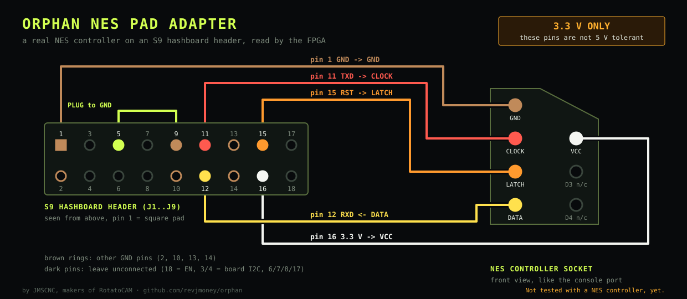

# Real NES pads on Orphan

Plug an original NES controller into the S9 control board and play the **Orphan NES** console with it. The FPGA reads
the pad itself (the 4021 shift register inside it) about 1000 times a second, with NES timing. Real pads and the
browser pads (keyboard, USB gamepad) work together.



> **3.3 V only.** The hashboard header pins go straight into the FPGA: no buffer, no protection, **not 5 V tolerant**.
> Power the pad from the header's 3.3 V pin (16), never from 5 V.

## What you need

- An S9 control board running Orphan, with the `orphan_nes` core
- An original NES controller (its CD4021 chip runs from 3 V to 15 V, so 3.3 V is fine).
  Some clone pads use other chips and may not run at 3.3 V.
- A 2x9 socket that fits the header on your board (check the pitch with calipers: 2.54 mm or 2.0 mm)
- An NES controller socket: the easiest is the socket end of an NES extension cable
- A multimeter (continuity and DC volts) and a soldering iron

## Wiring

| S9 header pin | Signal on the S9 board | NES socket | Official NES pad wire |
|---|---|---|---|
| 15 | RST (FPGA output) | LATCH (OUT) | orange |
| 11 | TXD (FPGA output) | CLOCK (CLK) | red |
| 12 | RXD (FPGA input) | DATA (D0) | yellow |
| 16 | 3.3 V | VCC (the "+5V" pin) | white |
| 1 (or 2, 9, 10, 13, 14) | GND | GND | brown |
| 5 | PLUG | tie to GND (pin 9) inside the adapter | none |

Leave every other header pin unconnected (18 is EN, driven by the ARM; 3, 4, 6, 7, 8 and 17 are not used).
D3 and D4 on the NES socket stay unconnected (the standard pad does not use them).

**PLUG to GND matters:** it tells Orphan an adapter is on this header. The FPGA only drives LATCH and CLOCK on a
header you picked **and** whose PLUG pin is low. Without the jumper the pad is never read.

The wire colours are those of an official NES pad cable. Extension cables and clones use other colours:
find each wire with the continuity tester, against the socket drawing (front view, like the console's own port).

## Before you plug a pad in

1. **Check the header numbering.** The drawing uses the usual 2x9 numbering: pin 1 is the square pad, odd pins in
   one row, even pins in the other. With the board powered, measure: pin 16 to pin 1 must read **3.3 V**.
   If it does not, stop and find the 3.3 V and GND pins on your board first.
2. **Pick a header without a hashboard.** Stock boards only have headers fitted on J6, J7 and J8. Never pick a header
   that has a hashboard on it. J1 to J5 and J9 are bare footprints you can solder a header into (whether pin 16 has
   3.3 V on a bare footprint is not checked yet: measure it).
3. **Empty-header test** (no pad plugged in yet): start the console with your two headers picked (below) and check that
   it prints `no adapter` for both pads. Something on the board pulling PLUG low would show up here first.

## Turn it on

The console reads pads on J1 (pad 1) and J2 (pad 2) unless told otherwise. Pick other headers with an environment
variable or a one-line file on the board:

```sh
ORPHAN_NES_PADS=7,8        # pad 1 on J7, pad 2 on J8
echo 7,8 > /etc/orphan/nespads
ORPHAN_NES_PADS=off        # real pads off
```

When the console starts it prints, for example, `Real NES pads on J7,J8: pad 1 adapter found, pad 2 no adapter`.
The console's web page (port 8000) has an **NES pads** button: it shows each pad's header, whether an adapter is
found, and lights every button as you press it.

## How it works

- `games/orphan_nes/orphan_nespad.v`: the reader. LATCH high for 12 us, then 8 bits with 6 us clock halves
  (A, B, Select, Start, Up, Down, Left, Right; low = pressed), one scan every 1.002 ms.
  A read no real pad can give (Up + Down or Left + Right at once) counts as no buttons, so a DATA line stuck
  low can not jam a game.
- `games/orphan_nes/top.v`: a 9-header crossbar, so any of J1 to J9 can be pad 1 or pad 2. The FPGA's weak
  pull-ups are on for all 36 header pins (the board has none).
- `games/orphan_nes/orphan_nes_block.v`, register 9 `HWPADS`: write `[0]` enable, `[7:4]` pad 1 header,
  `[11:8]` pad 2 header (1 to 9); read `[15:0]` the buttons, `[17:16]` pads being read, `[24]` enable.
  Register 10 reads both header numbers. Real pads are off after the FPGA loads, until `main.py` turns them on.
- `games/sim/tb_nespad.v`: the reader against a model of the 4021 (Icarus Verilog), 15 checks.

Pad facts (button order, latch and clock behaviour, wire colours, socket layout) are from the NESdev wiki:
[Standard controller](https://www.nesdev.org/wiki/Standard_controller) and
[Controller port pinout](https://www.nesdev.org/wiki/Controller_port_pinout).

## Status

Built and simulated; **not yet tried on a board or with a real pad.** Reports welcome as GitHub issues.

The drawing is made by `docs/nes-pad/make_adapter_svg.py` (it writes the same SVG for the docs, the website and the
console's page).

---
by JMSCNC, makers of RotatoCAM · [Rev. J. Money - 2026] · GPL-3.0-or-later
