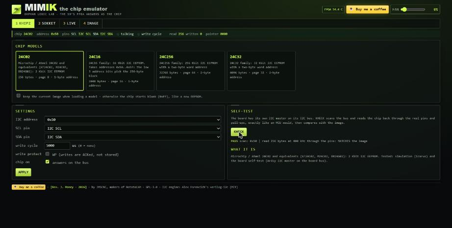
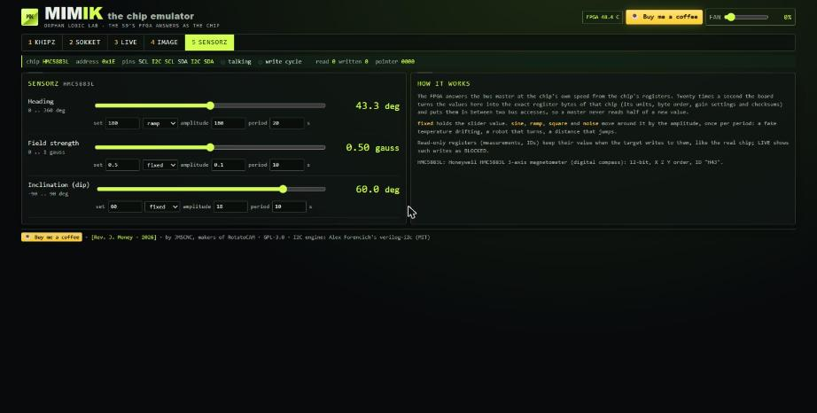

# MIMIK: the chip emulator

`[orphan] orphan_mimik` · branch `science` · part of the ORPHAN LOGIC LAB family (SPEKTOR / INJEKTOR)

[Rev. J. Money - 2026] · by JMSCNC, makers of RotatoCAM · GPL-3.0-or-later

The S9's FPGA answers **as a chip**, live, at the chip's own speed. Plug it in where a dead or missing chip was, or
fake a chip to see what a board does with it. It emulates I2C EEPROMs (the 24Cxx family) and I2C sensors whose readings you set. SPI flash and
parallel ROMs come next (see [DESIGN.md](DESIGN.md)).

## What works (v1)

- The **I2C target engine** in the FPGA (`mimik_i2c.v`) at 100 kHz, 400 kHz and 1 MHz. It works like a real 24Cxx:
  - random, current-address and sequential reads, which roll over at the end of the chip
  - page writes that wrap inside their page
  - the write cycle: after a write the chip does not answer its address (ACK polling works)
  - WP: writes are ACKed but not stored
  - one-byte chips that answer on several addresses (24C16: 0x50..0x57 pick the block)
  - two-byte word addresses (24C32, 24C256)
- A 32 KB image in block RAM. What the bus master writes is kept like in a real EEPROM: it is saved to
  `image.local.bin` and loaded again at the next start.
- SCL / SDA can be the board's own I2C bus or **any** of the 36 header pins (J1..J9 pins 5, 11, 12, 15). All are open
  drain.
- **Chip models are plugins:** `models/<chip>/model.json` (plus README.md, optional image.bin). Included: 24C02,
  24C16, 24C32, 24C256.
- **The page (port 8000):**
  - KHIPZ: models, settings, and the KHECK self-test
  - SOKKET: the wiring drawing
  - LIVE: every bus access as it happens, plus a hit map of the bytes the target uses
  - IMAGE: hex editor, .bin load / save, fill
  - plus the coffee button and the fan slider. Keys 1..4 switch pages.

## Sensor chips (values you control)

The second family: sensors that report **whatever values you set**. Each value is a slider on the SENSORZ page, or
moves by itself (sine, ramp, square or noise around the slider, with an amplitude and a period). Twenty times a
second the board turns the values into that chip's exact register bytes (its units, byte order, gain settings and
checksums) and puts them in between two bus accesses, so a master never reads half of a new value.

| Family | Chip | Address | Values |
|---|---|---|---|
| temperature | TMP102, LM75 | 0x48 | temperature |
| infrared | MLX90614 (IR thermometer, with SMBus PEC) | 0x5A | object and ambient temperature |
| distance | SRF02 (ultrasonic) | 0x70 | distance (cm / inch / us by command, no ACK while it "pings") |
| distance | TF-Luna (LiDAR, I2C mode) | 0x10 | distance, signal strength, temperature |
| compass | HMC5883L, QMC5883L | 0x1E, 0x0D | heading, field strength, inclination |
| motion | MPU-6050 | 0x68 | accel X Y Z, gyro X Y Z, temperature |
| light | BH1750 | 0x23 | lux |

What the engine does for these:
- **Register mode.** The byte after the address picks a 16-bit or 32-bit register, and every read streams that
  register. This is how LM75, TMP102, BH1750 and MLX90614 work.
- **Read-only bytes.** Measurement and ID registers keep their value when the target writes to them, like the real
  chip. LIVE shows those writes as BLOCKED.
- **Driver settings are followed.** The models read the settings registers the driver writes, so the counts change
  with them: gain (HMC5883L), range (QMC5883L, MPU-6050) and units (SRF02).

Each model is a folder: `model.json` lists the controls, and `model.py` has `setup(chip)`, `update(chip, values)`
and an optional `on_event(chip, event, values)`. Each model's README lists its registers. Where a register map
is not checked against a real part, its README says so (TF-Luna).

## Wiring

**3.3 V only.** The FPGA pins are not 5 V tolerant, so a 5 V bus needs an I2C level shifter.

| Signal | Where |
|---|---|
| SDA | pin 3 of J1..J8 (the board's I2C bus, 1 kohm pull-ups on the board) |
| SCL | pin 4 of J1..J8 |
| GND | pins 1, 2, 9, 10, 13, 14 of any J connector |
| or: any header pin | J1..J9 pins 5, 11, 12, 15 (set on KHIPZ). The target bus needs its own pull-ups (2.2 to 4.7 kohm to 3.3 V). |

Where these numbers come from:
- The header pins and GND are from Ardzy's tested table (`docs/pinmap.md`).
- The I2C bus on pins 3 / 4 is from Ardzy's guide (05_spi_i2c). **We have not measured it on our board yet.**
  Check it with a meter before the first connection.

Do not connect the S9's 3.3 V (pin 16) to a powered target.

## Tested

| Level | How | Result |
|---|---|---|
| Simulation | `sim/test_i2c.py` (memory chips, register mode, read-only bytes): Icarus Verilog. Ardzy's real I2C master RTL talks to MIMIK; a Python model of a 24Cxx says what every byte must be. | 99 / 99 checks ([docs/sim-result.txt](docs/sim-result.txt)) |
| The board's own pins | `hw_test.py` on board 2. MIMIK and Ardzy's I2C master share the real pads W18 / W19 with the board's pull-ups. | 20 / 20, 9 random seeds ([docs/hw-result.txt](docs/hw-result.txt)) |
| Sensor chips | `sensor_test.py` on board 2: every model is read by the board's I2C master the way its usual driver reads it, and the bytes are decoded with the datasheet formulas, separately from the model code | 30 / 30 |
| The page | Chrome against board 2: KHECK (memory and register chips), LIVE, IMAGE, SOKKET, SENSORZ with a moving value | works (screenshots in docs/screenshots) |
| **An outside I2C master** (Raspberry Pi, ESP32, a real target board) on J6..J8 pins 3 / 4 | | **not done yet** |

What hw_test.py checks:
- full 256-byte reads at 100 kHz, 400 kHz and 1 MHz
- page wrap
- 40 random page writes, then a full compare
- NACK on a wrong address
- WP
- write-cycle ACK polling (measured 5.1 ms for a 5 ms setting)
- the event log
- 24C16 block addressing
- a 32 KB 24C256 image, including the page wrap at the top of the chip
- the pointer reset after a model change

Build: `py -3 games-work/build.py lab-work/orphan_mimik` (Ardzy's flow). The result is 160 MHz, which passes the
100 MHz it needs, and uses 7 % of the LUTs and 9 block RAMs.

## Registers (slot 1, "MMK1")

They are listed in the header of `mimik_i2c.v`:
- CTRL: enable, WP, 2-byte address, device address, address mask
- SIZE and PAGE
- TWR (the write cycle in µs)
- STATUS and PTR
- EVENT (the 512-deep live log)
- COUNTS
- MEMADDR / MEMDATA (the ARM's image port)
- PINS

Slot 2 is Ardzy's I2C master on the board bus; KHECK uses it. Slot 15 is the fans.

## Write a chip model

Copy `models/24c02`, change `model.json` (`config`: address, address_mask, size, page, address_bytes,
write_cycle_us) and README.md, then send a pull request. Most I2C memory chips need no Verilog.

## Credits

- The I2C bus state machine is Alex Forencich's [verilog-i2c](https://github.com/alexforencich/verilog-i2c)
  `i2c_slave.v` (MIT), unmodified. See [NOTICE](NOTICE).
- Built on Ardzy by chryso (GPL-3.0).
