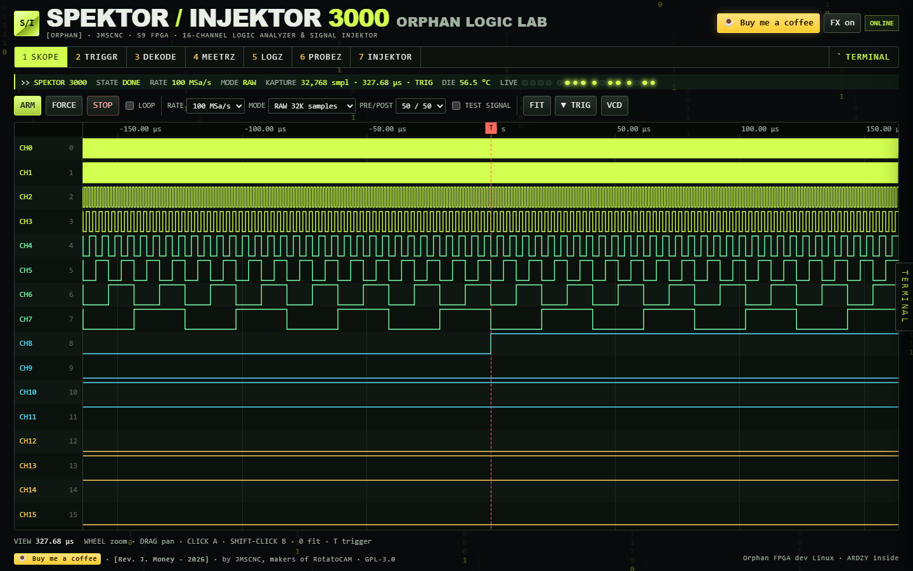
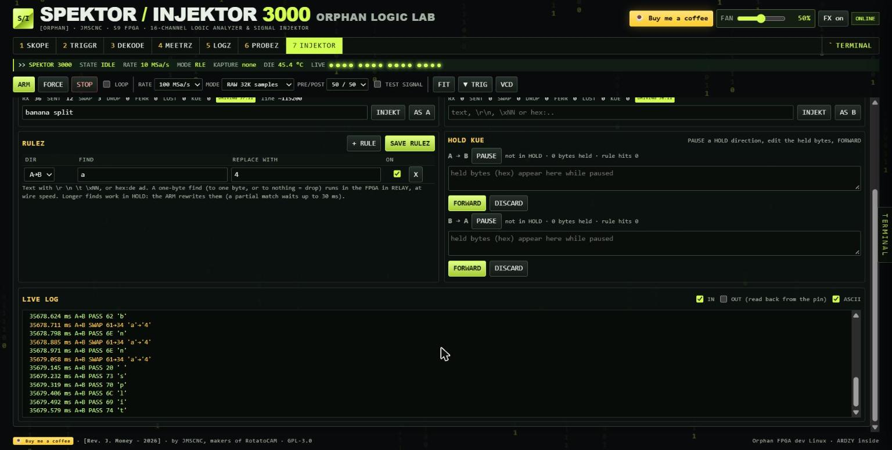
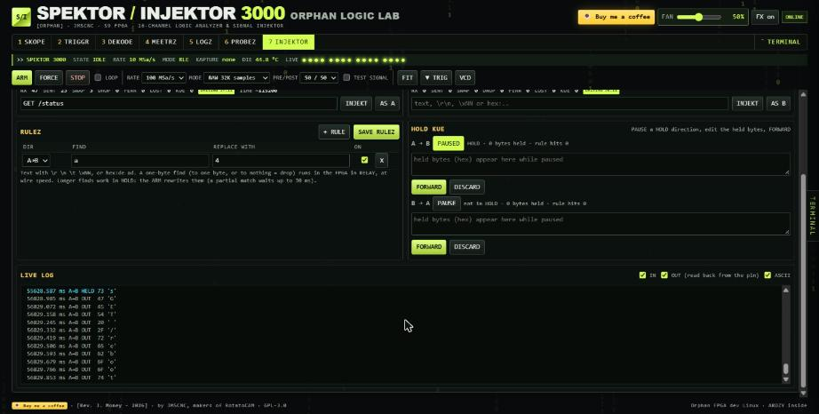

# ORPHAN LOGIC LAB: SPEKTOR / INJEKTOR 3000

**[orphan]** · by JMSCNC, makers of RotatoCAM · [Rev. J. Money - 2026] · GPL-3.0-or-later

[](https://buymeacoffee.com/revjmoney)

A 16-channel logic analyzer built into the FPGA of a retired Antminer S9 control board (Zynq XC7Z010).
SPEKTOR captures, triggers and decodes. INJEKTOR is the signal output half: its first module, **INTERSEKTOR**,
a UART man-in-the-middle bridge, is live (below). Replay, pattern generator, protocol drive, SPI MITM, JTAG finder
and glitcher come with the next cores; their bays are already in the page.



## What it does

| | |
|---|---|
| Channels | 16, 3.3 V LVCMOS, on four hashboard headers |
| Sample rate | 100 MSa/s down to 1 kSa/s (100 MHz / (DIV + 1)) |
| RAW depth | 32,768 samples (two per 32-bit block RAM word) |
| RLE depth | 16,384 runs of up to 65,536 samples each: seconds of a slow bus |
| Trigger | 4-stage sequencer. Per stage: level (0/1/X) and rise/fall/any edge per channel, plus a repeat count |
| Trigger position | sample-exact in RAW and RLE (the trigger sample always starts its own RLE run) |
| Pre/post | 10/90, 25/75, 50/50, 75/25, 95/5 of the ring |
| Dekoders | UART (5 to 9 bits, parity, invert, auto-baud), I2C (start, repeated start, stop, address R/W, ACK/NAK), SPI (modes 0 to 3, MSB/LSB first, CS framing) |
| Export | VCD (PulseView, GTKWave), CSV, JSON kapture files you can load back |

## Quick start

1. In the Orphan menu: **Load core** then `orphan_spektor` (or `ardzy load orphan_spektor`). The page opens on port 8000.
2. Tick **TEST SIGNAL** and press **ARM**. The built-in pattern (counter bits) fills the SKOPE.
3. Wire real signals (3.3 V only, see below), set a trigger on **TRIGGR**, pick RATE and MODE, press **ARM**.
4. Add a dekoder on **DEKODE**. Save a **VCD** for PulseView.

## Wiring

Every hashboard header (J1 to J9) is a 2x9, 2.54 mm header, and pins 5, 11, 12 and 15 of each go straight into the
FPGA: 36 inputs in all. SPEKTOR wires all 36 in and a **kanal map** (a crossbar in the FPGA) picks which header pin
each of CH0..CH15 samples. Change it on PROBEZ card 1, or in the terminal (`map 3 J1.11`, `map stock`); it is saved
on the board.

Default map (the S9's stock headers first; the stock ribbon cables fit J6, J7, J8):

| Header | pin 5 | pin 11 | pin 12 | pin 15 |
|---|---|---|---|---|
| J6 | CH0 | CH1 | CH2 | CH3 |
| J7 | CH4 | CH5 | CH6 | CH7 |
| J8 | CH8 | CH9 | CH10 | CH11 |
| J9 | CH12 | CH13 | CH14 | CH15 |

- Stock boards have only J6, J7, J8 fitted. For the others solder a 2x9 2.54 mm pin header into the footprint;
  the pins connect straight to the FPGA, nothing to jumper.
- GND on pins 1, 2, 9, 10, 13, 14. 3.3 V out on pin 16 (small loads only). Pin 18 is EN from the ARM side: leave it alone.
- **3.3 V only.** No buffer, no protection, not 5 V tolerant. For 5 V logic build the 74LVC245A front end (PROBEZ card 3).
- The board has no pull-ups on these pins (measured 2026-11-22). SPEKTOR turns on the FPGA's weak internal
  pull-ups, so an unconnected channel reads 1.
- PROBEZ card 1 also shows all 36 pins live (a ring = high): a pin finder for unknown wiring.
- Check pin 1 with a meter before your first harness: GND on pins 1 and 2.

The **PROBEZ** page has 8 slide-in cards with drawings: the ports, a 16-channel ribbon harness, the 5 V front end,
a UART tap, an I2C klip (24Cxx), an SPI flash klip (25xx), JTAG/SWD hunter leads, and the limits.

## The page

Menu bar (keys 1 to 7), a status line, the kapture bar, and pages that slide in from the side:

- **SKOPE**: the waveforms. Wheel zooms at the mouse, drag pans, click sets cursor A, shift-click or right-click sets B
  (time, delta, 1/delta and samples between). Click a channel label to hide it, double-click to rename it
  (names are saved on the board). Dense areas draw as solid blocks. Dekoder lanes run under the channels.
- **TRIGGR**: a channel x stage grid. Click a cell to cycle `X 0 1 ↑ ↓ ↕` (shift-click goes back). TIMES = matching
  samples the stage needs. Presets: rising edge, UART start bit, I2C START, SPI chip select, two-stage glitch hunt, Nth edge.
- **DEKODE**: add UART, I2C and SPI dekoders; a listing (click a row to jump there) and the UART text stream.
- **MEETRZ**: per channel edges, frequency, duty, min/max high and low pulse; a cursor table with edges and levels at A and B.
- **LOGZ**: the last 12 kaptures of this browser tab (view, VCD, CSV), save/load JSON, the event log.
- **PROBEZ**: probe builder cards (arrow keys flip them).
- **INJEKTOR**: the output modules and their pins.
- **PROBEZ card 1**: the kanal map editor and the live pin view of all 9 headers.
- **TERMINAL**: a drawer that slides in from the right (the ` key or the tab on the right edge).

Keys: `1`-`7` pages, `A` arm, `F` force, `S` stop, `T` center the trigger, `0` fit, `+`/`-` zoom, arrows pan, `` ` `` terminal, `Esc` close it.
Links: `#skope`, `#triggr`, `#dekode`, `#meetrz`, `#logz`, `#probez-3` (card 3), `#injektor`.

### Terminal commands

```
arm [raw|rle] [rate 1M] [test]   arm the trigger
force | stop                     trigger now | stop and read
status                           state, rate, live pins
trig <ch> <x|0|1|r|f|e> [stage]  set a trigger cell, "trig clear"
name <ch> <text>                 rename a channel
uart <ch> [baud|auto]            add a UART dekoder
i2c <scl> <sda> | spi <clk> <mosi> <miso> <cs> [mode]
dump [n]                         print dekoded frames
meas <ch>                        frequency and duty
vcd | csv                        save the kapture
page <name>                      switch page
```

## How the trigger works

Each stage has a MASK/VALUE (levels), a RISE mask and a FALL mask (a channel in both = any edge) and a COUNT.
A stage matches on a sample when every masked channel has its level, every RISE channel just went 0 to 1 and every
FALL channel just went 1 to 0. It must match COUNT + 1 samples (they need not be back to back), then the next stage
arms; the last used stage fires the trigger. With no conditions at all the page simply captures at once.

## Inside

| File | What |
|---|---|
| `spektor.v` | the capture core: input synchronizers, test pattern, divider, RAW/RLE packer, trigger sequencer, 16384 x 32 block RAM ring, pop-read port |
| `top.v`, `pins.xdc` | slot 0 info ("SPK1"), slot 1 SPEKTOR, slot 15 fans; all 36 header pins with weak pull-ups; LED D5 armed, D6 triggered |
| `spektor_hw.py` | `Spektor` class: `arm()`, `force()`, `stop()`, `read()` (runs), `to_vcd()` |
| `main.py` | web service on port 8000: `/api/status`, `/api/capture`, `/api/vcd`, POST `arm`/`force`/`stop`/`fetch`/`names` |
| `index.html` | the page |

Registers (slot 1, word index): 0 CTRL (arm, stop, force), 1 STATUS, 2 DIV, 3 MODE (rle, test, stages-1), 4 POST,
5 TRIG_AT (RAW `{word, half}`, RLE word), 6 WPTR, 7 FILLED, 8 LIVE, 9 SAMPLES, 10+4s MASK|VALUE, 11+4s RISE|FALL,
12+4s COUNT, 30 RDPTR, 40+c channel c's header pin (0..35), 56/57 the raw 36 pins, 768..1023 ring pop, 127 ID.

From Python on the board:

```python
from spektor_hw import Spektor
s = Spektor()
s.arm(div=9, rle=False, post=8192, stages=[{'fall': 1 << 0}])   # 10 MSa/s, trigger on CH0 falling
values, counts, trig, rle = s.read()                              # runs of 16-bit samples
```

Tested on hardware (board 2): edge spacing exact in RAW and RLE, rise/fall/any/level+edge triggers land on the exact
sample in both modes, the divider, force and stop; the UART, I2C and SPI dekoders against known bytes.

## INTERSEKTOR: the UART man-in-the-middle bridge (INJEKTOR page)



Cut the serial line between two devices and put the S9 in the middle. Every byte, both ways, is logged with a
microsecond time stamp, and you decide what goes through.

```
 device A TX ──> J6.5      J7.11 ──[330R]──> device B RX        (direction A → B)
 device A RX <──[330R]── J6.11      J7.5 <── device B TX        (direction B → A)
 GND ─────────── J6 pin 1/2 ── J7 pin 1/2 ─────────── GND
```

| Mode (per direction) | What happens |
|---|---|
| OFF | listen only: the output pin is not driven, bytes are still logged (a sniffer) |
| WIRE | bit-level pass-through in the FPGA, under 100 ns of delay, any baud and any frame format |
| RELAY | each byte goes through a 256-entry table in the FPGA (pass, swap to another byte, drop) and is sent again, one frame later; you can INJEKT your own bytes in between |
| HOLD | bytes go to the ARM: sequence rules rewrite them (find / replace of any length), or PAUSE and edit them by hand in the HOLD KUE, then FORWARD |

- **RULEZ**: text with `\r \n \t \xNN`, or `hex:de ad`. A one-byte find (to one byte, or to nothing = drop) runs in
  the FPGA in RELAY at wire speed. Longer finds need HOLD (a partial match waits up to 30 ms for the rest).
- **INJEKT**: send your own bytes to either device (512-byte queue per direction).
- **AUTO baud**: the core measures the shortest pulse on each input; AUTO sets the nearest standard baud.
- **Safety**: nothing is driven until **GO**, and GO is never saved (the bridge always starts with its outputs off).
  A direction whose output pin is an input in use, or the other direction's output, is not driven (PIN CONFLICT).
  If the web service stops answering in HOLD, the FPGA falls back to RELAY after 250 ms (FAILSAFE), so the link
  keeps working.
- Store and forward never overruns: while bytes are waiting, the stop bit is sent 3/4 long, so a sender up to about
  2.5 % fast is kept up with (tested at 2.4 %). Framing errors and breaks are logged, not forwarded (use WIRE to
  pass those).
- Frames are 8N1. Other formats (parity, 7 bits, 2 stop bits): use WIRE.
- Pins are any of the 36 header pins (IN / OUT selects); defaults as drawn above. SPEKTOR keeps capturing while the
  bridge runs, and its CH0 / CH1 / CH4 / CH5 are exactly the four wires (default kanal map).
- **TEST**: two built-in test UARTs play device A and device B (the AS A / AS B buttons), so you can try it all with
  nothing wired.

Terminal: `mitm`, `mitm go`, `mitm stop`, `mitm a2b relay 115200`, `inject b2a hello\r\n`, `rule a2b a 4`
(`rule a2b x -` drops x).



### Tested

- Simulation (`sim/test_ik.py`, Icarus): **40 of 40**. The bench's devices are written with their own timing,
  separate from the core: a 200-byte burst 2.4 % fast with nothing lost, a 2 % slow sender, 9600 baud passed
  bit by bit through WIRE with the core set to 115200, WIRE delay under 100 ns, swap/drop, inject during traffic,
  HOLD with an edited copy, FAILSAFE, a break, the baud finder, pin conflicts, TEST mode, OFF sniffing.
  Result: `docs/sim-result-intersektor.txt`.
- Board 2 (`ik_hw_test.py`): **20 of 20**. The bridge drives its real pins and SPEKTOR captures them from the pads;
  the script decodes the UART from the raw samples itself: RELAY both ways, 9600 and 1,000,000 baud, the swap
  table, INJEKT, WIRE, HOLD with sequence rules, FAILSAFE, the baud finder, the conflict guard.
- The page in Chrome on board 2: modes, GO, a live swap rule, PAUSE + hand edit + FORWARD, the terminal.
- **Not yet tested**: two real outside devices on the wires (all board tests used the built-in test UARTs).

## Roadmap: INJEKTOR

Protocol drive (UART/I2C/SPI master), rekord/replay of kaptures, pattern generator, DDS/PWM, SPI MITM,
JTAG/SWD finder, GLITCHR; a SUMP/sigrok link so PulseView can drive SPEKTOR directly; sigrok-cli in the distro.

Built on Ardzy (by chryso, GPL-3.0): ardzy_bus, ardzy_info, the board tools. "Bus Pirate" is a trademark of its owners;
SPEKTOR / INJEKTOR is an independent design.

---
[Rev. J. Money - 2026] · by JMSCNC, makers of RotatoCAM · [Buy me a coffee](https://buymeacoffee.com/revjmoney)
