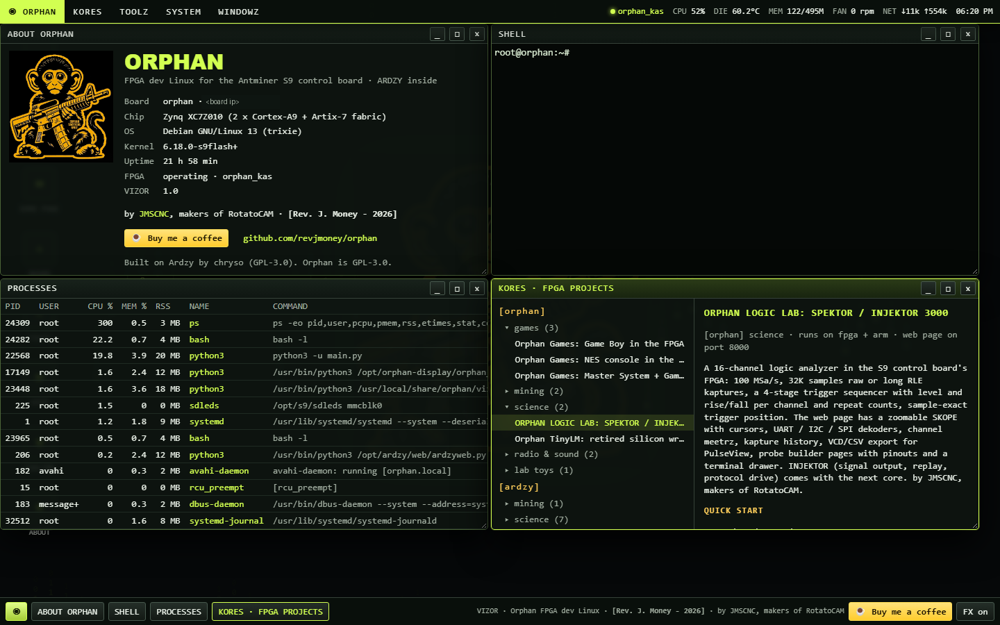
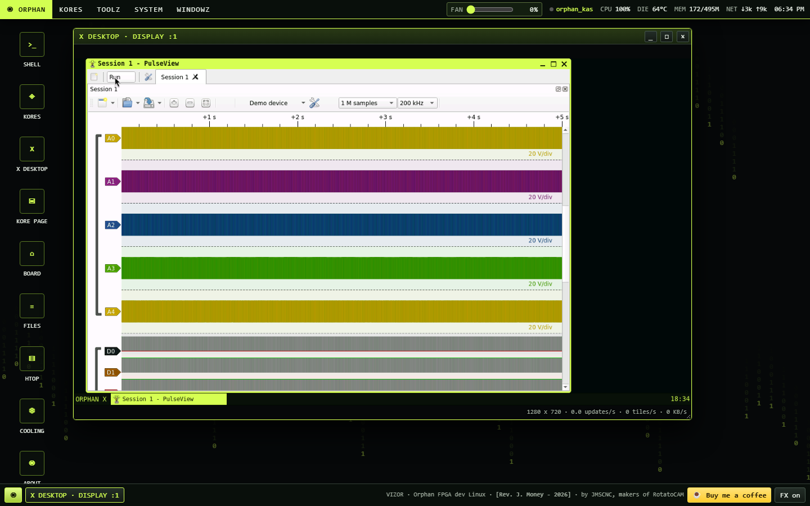

# VIZOR: the Orphan desktop in your browser

**[orphan]** · by JMSCNC, makers of RotatoCAM · [Rev. J. Money - 2026] · GPL-3.0-or-later

Open **http://orphan.local:8080** (or `http://<board ip>:8080`) and the S9 board becomes a desktop: matrix rain,
a menu bar like the Orphan terminal menu, windows you can drag, resize, tile and minimize, and a real shell.
Your browser does the drawing, so it is as smooth as your PC. The board only sends data.

## What is in it

| Menu | Items |
|---|---|
| **◉ ORPHAN** | About Orphan, About this board (fastfetch), Buy me a coffee, Orphan on GitHub, the Orphan menu in a terminal |
| **KORES** | every FPGA project as a tree ([orphan] / [ardzy] split into games, mining, science, radio & sound, lab toys, starters & tests), open the loaded kore's page, stop the kore |
| **TOOLZ** | Shell, Midnight Commander, htop, Processes, Network, Cooling, the Board page (Ardzy inside), the kore log |
| **SYSTEM** | the Orphan menu (options and settings), restart the kore program, Reboot, Power off (both ask first) |
| **WINDOWZ** | tile, cascade, minimize all, close all, and every open window |

- **Tray**: the loaded kore (a lime dot = its program is running), hashrate when a miner is loaded, CPU, die
  temperature, memory, fans, network in/out, clock.
- **KORES window**: pick a project, read its summary and quick start, **LOAD** it into the FPGA. If it has a web page,
  VIZOR opens it in a window by itself.
- **Desktop icons** (double-click): SHELL, KORES, KORE PAGE, BOARD, FILES, HTOP, COOLING, ABOUT.
- **Taskbar**: every window, the coffee button, FX on/off for the rain.
- **Shell windows**: xterm.js over a WebSocket to a real login shell (`bash -l`, colours, resize, htop and mc work).
  If the PC has no internet to load xterm.js, a plain line terminal is used instead.
- **Links**: `#shell`, `#kores`, `#board`, `#core`, `#about`, `#procs`, `#cooling`, `#menu`; combine them and add
  `tile`, for example `http://orphan.local:8080/#kores,shell,tile`. `Alt` + `` ` `` opens a new shell.

## X DESKTOP: real Linux apps

**X DESKTOP** (desktop icon, or TOOLZ, X APPZ) shows a real X11 screen running on the board: Xvfb (1280 x 720,
16-bit) with the JWM window manager in the Orphan look. **PulseView**, **GTKWave** and **xterm** start from TOOLZ, from
JWM's ORPHAN X menu (click the X desktop), or with `#pulseview`, `#gtkwave`, `#xterm`, `#x` links. Mouse, wheel and
keys go back to X (XTest).

How it moves: the board compares the screen in 16 x 16 tiles about 20 times a second and sends only the tiles that
changed, zlib-packed, over a WebSocket; the browser unpacks them (DecompressionStream) onto a canvas. The X screen
starts only when the window opens (`vizor-x.service`) and stays up for the next time.

Measured on board 2 (2026-11-22): a full 1280 x 720 screen packs from 1800 KB to 56 KB, so the 100 Mbit network is not
the limit; **finding the changed tiles costs the ARM about 54 ms per scan** (one core), which is the job the planned
BLITTR FPGA core takes over (see `BLITTR.md`). PulseView itself is slow on the A9 (about 20 s to start) but works,
demo device included. Packages: `xvfb jwm python3-xlib pulseview gtkwave xterm fonts-dejavu-core x11-xserver-utils`
(about 96 MB).

### Programs show up by themselves

Every program that installs a standard launcher (a `.desktop` file, which nearly all Linux GUI programs ship) appears
in VIZOR's TOOLZ menu and in JWM's ORPHAN X menu, sorted into sections (Science & electronics, Development, Graphics,
Internet, Accessories, System...). An apt hook (`/etc/apt/apt.conf.d/99orphan`) rebuilds the JWM menu after every
install or removal; VIZOR re-reads the list every minute. Terminal programs open inside xterm.

### X SETTINGS

TOOLZ, X settings: screen size (1024 x 600 up to 1920 x 1080), DPI, keyboard layout (`us`, `gb`, `de`...) and the
background colour. Saved in `/etc/orphan/vizor-x.env`; saving restarts the X screen.

### apt on Orphan

apt only offers packages built for this board's CPU (Debian armhf), so whatever installs will run. Orphan adds two
things: no "recommended" extras by default (lean installs), and a block on the full desktop environments (GNOME, KDE
Plasma, Cinnamon, MATE, Xfce and LXQt task packages), which are far too big for 512 MB of RAM with no GPU
(`/etc/apt/preferences.d/orphan`; remove it to allow them anyway). Single programs from those desktops still install.

## Fan slider everywhere

`fan.js` (served by VIZOR) puts a small FAN slider in the header of every Orphan page: the board page, every Orphan
core's page on port 8000, and VIZOR's tray. It reads and sets the fans through VIZOR's `/api/fan`, which accepts pages
from this board on any port and refuses other web sites. The duty is saved on the board and used at boot.

## Safety

VIZOR has no password, like the rest of Orphan's web pages, so keep the board on your own network.

- It answers only addresses on the local network (private, loopback, link-local).
- The shell and every change (POST) must come from VIZOR's own page (the browser's Origin header is checked), so a
  web site you visit cannot open a shell on the board behind your back.
- Turn the shell off with `echo '{"shell": false}' > /etc/orphan/vizor.json` (then `systemctl restart vizor`).

## Files

| File | What |
|---|---|
| `vizor.py` | the service (Python standard library only): the page, `/api/sys`, `/api/projects`, `/api/app`, `/api/fan`, `/ardzy/...` (a pass-through to the Ardzy API on port 80), `/ws/shell` |
| `index.html` | the desktop |
| `vizor.service` | systemd unit (installed and enabled by `orphan/install.sh`) |
| `vizor-x.sh`, `vizor-x.service`, `jwmrc` | the X desktop: Xvfb :1 + JWM (started on demand) |
| `fan.js` | the fan slider for every page's header |
| `xapps.py` | installed programs from their .desktop launchers; `--jwm` rebuilds JWM's menu |
| `apt-orphan.conf`, `apt-orphan.pref` | the apt hook and policy (installed as `/etc/apt/apt.conf.d/99orphan`, `/etc/apt/preferences.d/orphan`) |
| `BLITTR.md` | the plan for an FPGA graphics core that streams real X11 apps into a VIZOR window, and HDMI out |

Port 8080 by default (`VIZOR_PORT` to change it). Logs: `journalctl -u vizor`.

## Next

- The BLITTR core: move the tile scan (54 ms on the ARM) into the FPGA. See `BLITTR.md`.
- HDMI out on J6/J7 (the PicoDVI way). See `BLITTR.md` and `docs/headers.md`.

---
[Rev. J. Money - 2026] · by JMSCNC, makers of RotatoCAM · [Buy me a coffee](https://buymeacoffee.com/revjmoney)
